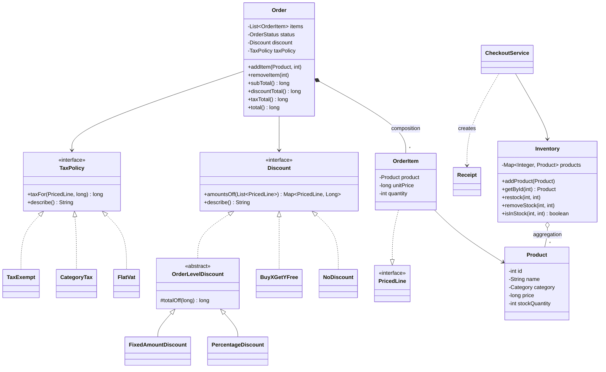

# Point of Sale (POS) Inventory & Sales System OOP

A point-of-sale system written in plain Java, with no external libraries. It manages a product inventory, builds customer orders, applies discounts and tax, checks out against stock, and prints receipts. It has a Swing GUI and a console menu.

The project is an exercise in object-oriented design:

- **Composition and aggregation:** an `Order` owns its `OrderItem`s, and each `OrderItem` refers to a `Product` that lives in the `Inventory`.
- **Polymorphism:** tax and discount rules are interchangeable objects behind the `TaxPolicy` and `Discount` interfaces.

## Requirements

- JDK 18 or newer. The source files contain the `₦` symbol, and JDK 18+ reads source as UTF-8 by default.
- Check your version with `java -version` and `javac -version`.

## Build and run

Run these from the project root, the folder that contains `pos/`.

### 1. Compile to bytecode

```bash
javac -d out $(find pos -name "*.java")
```

This compiles every `.java` file under `pos/` and writes the `.class` files (bytecode) into `out/`. Recompile after every code change; otherwise `java` runs the old bytecode.

> **Windows PowerShell:** `$(find ...)` is Bash syntax. Use Git Bash, or this PowerShell equivalent:
> ```powershell
> javac -d out (Get-ChildItem -Recurse pos -Filter *.java).FullName
> ```

### 2. Run

```bash
java -cp out pos.GuiMain   # Swing GUI
java -cp out pos.Main      # console menu
java -cp out pos.Demo      # scripted demo with pricing checks
```

`-cp out` tells Java to load classes from `out/`. The last argument is the fully qualified name of the class whose `main` method to run.

| Entry point | What it does |
|---|---|
| `pos.GuiMain` | Opens the desktop window: product list, current order, discount and tax pickers, live totals, checkout with a receipt dialog. |
| `pos.Main` | Text menu version of the same features. Enter `0` to exit. |
| `pos.Demo` | Runs inventory, order and pricing scenarios, including failure cases. Each pricing case prints `Check: ... -> OK` when the total matches the expected value. |

If `₦` shows as `?` in the console, switch the terminal to UTF-8. In PowerShell, run `chcp 65001` and then use `java "-Dstdout.encoding=UTF-8" -cp out pos.Main`. The GUI is not affected.

## Using the GUI

1. Select a product on the left. Set **Qty**, then click **Add to order**, or double-click the product.
2. Choose a **Discount** and click **Apply**. You are asked for the details, such as the percent or amount.
3. Choose a **Tax** policy. The totals update straight away.
4. Click **Checkout** to take the stock out of inventory and show the receipt. A new order starts automatically.

Stock is colour-coded: amber means low and red means sold out. The GUI won't let you add more than is in stock.

## Architecture

```
pos/
├── GuiMain.java, Main.java, Demo.java   entry points
├── SampleData.java                      starter products
├── domain/                              business rules (no UI code)
│   ├── Money.java                       kobo formatting and the rounding rule
│   ├── exceptions/                      InsufficientStockException
│   ├── product/                         Product, Category, Inventory
│   ├── order/                           Order, OrderItem, OrderStatus
│   ├── pricing/
│   │   ├── interfaces/                  Discount, TaxPolicy, PricedLine
│   │   ├── discount/                    NoDiscount, PercentageDiscount, FixedAmountDiscount,
│   │   │                                BuyXGetYFree, OrderLevelDiscount (base class)
│   │   └── tax/                         FlatVat, CategoryTax, TaxExempt
│   └── receipts/                        Receipt, ReceiptLine
├── services/                            CheckoutService
└── ui/                                  ConsoleApp, ReceiptPrinter, AppInfo
    └── gui/                             PosWindow (Swing)
```

### Layers

Dependencies only point downward:

```
ui  (ConsoleApp, PosWindow, ReceiptPrinter)
 │
services  (CheckoutService)
 │
domain  (Order, Inventory, pricing, receipts)
```

- **domain** holds all the business rules. Every class validates its own input and protects its own state; for example, an `Order` can't be changed once it's paid.
- **services** coordinates several domain objects. `CheckoutService` checks stock for every line, deducts it, marks the order paid and returns a `Receipt`. It checks everything before deducting anything, so a failed checkout leaves inventory untouched.
- **ui** only displays state and forwards user actions. The console and the GUI share the same domain and service code, and `ReceiptPrinter.format()` produces the same receipt text for both.

### Class diagram



### Key design decisions

**Composition: `Order` owns `OrderItem`.** `OrderItem`'s constructor and `increaseQuantity()` are package-private, so only `Order` can create or change items, and `getItems()` returns a read-only copy. Adding the same product twice merges it into one line. An item copies the product's price when it is added, so a later price change doesn't affect an open order.

**Aggregation: `OrderItem` → `Product`.** Products live in the `Inventory` independently of any order. An item only refers to one.

**Polymorphism: discounts and tax.** `Order` only knows the `Discount` and `TaxPolicy` interfaces, so a new rule is a new class and `Order` doesn't change. `NoDiscount` and `TaxExempt` are null objects: they stand in for "nothing applies", so there are no null checks.

| Discount | Behaviour |
|---|---|
| `NoDiscount` | Nothing off. |
| `PercentageDiscount` | A percentage of the subtotal. Use `PercentageDiscount.ofPercent(10)` for 10%; the constructor takes basis points (1000 = 10%). |
| `FixedAmountDiscount` | A fixed amount in kobo, capped at the subtotal. |
| `BuyXGetYFree` | Free units on one product's line only. |

| Tax policy | Behaviour |
|---|---|
| `FlatVat` | One rate on every line. The default is 7.5% (750 basis points). |
| `CategoryTax` | VAT, except on the categories you exempt (for example `FOOD`). |
| `TaxExempt` | No tax. |

**Tax is charged on discounted prices.** A discount returns the amount off for *each line* (`Map<PricedLine, Long>`). Order-wide discounts extend `OrderLevelDiscount`, which spreads the total across the lines in proportion to their value; the shares always add up to the exact amount. `Order` then taxes each line on its total minus its discount, and rejects any discount result that is negative or bigger than its line.

**No package cycle.** Pricing rules see lines only through the `PricedLine` interface, which `OrderItem` implements. So `order` depends on `pricing`, and `pricing` never depends on `order`.

**Money is an integer.** All amounts are `long` kobo (₦1 = 100 kobo), and all rates are `int` basis points (100 = 1%). There is no `double`, so there are no floating-point rounding errors. `Money.applyRate()` is the one rounding rule for the whole system: round to the nearest kobo, halves round up.

## Sample data

`SampleData.seed()` loads six products with IDs 1 to 6: food, electronics, clothing, and one sold-out item (Notebook). Every entry point uses it, so all three start with the same stock.
